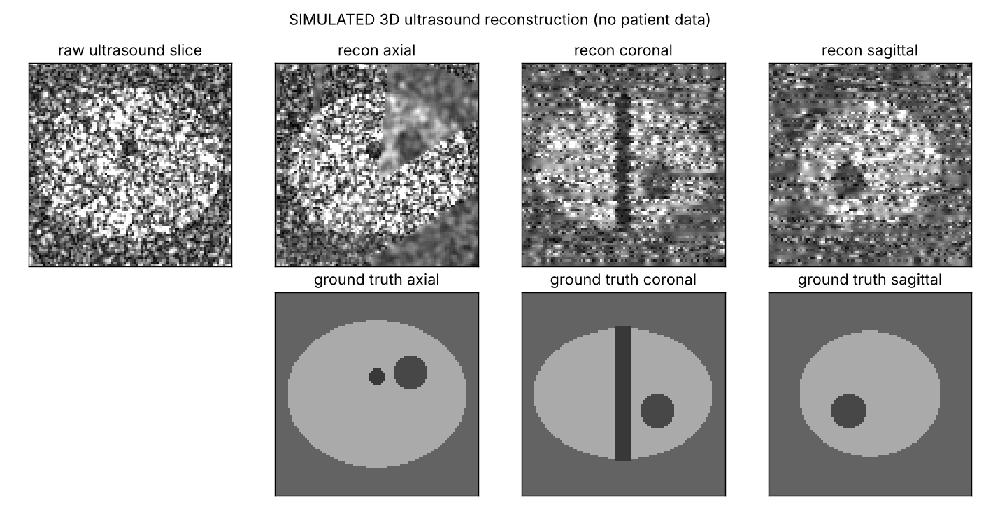
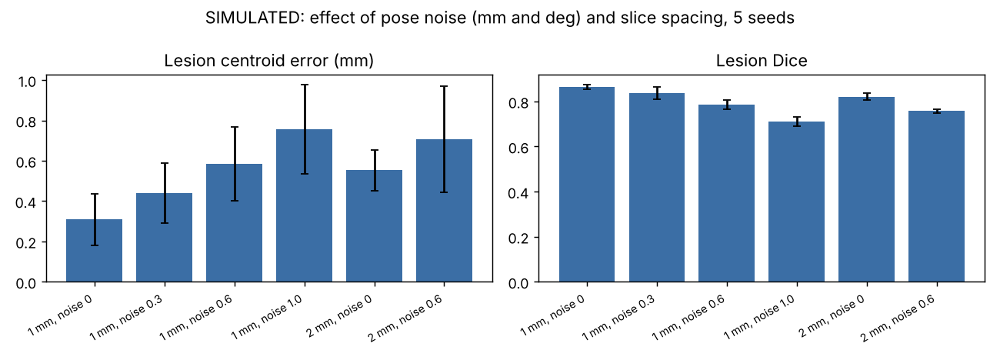

# Medical-Image-Reconstruction

3D freehand ultrasound reconstruction for prostate biopsy guidance, written in **C++ (OpenCV)** and **Python (NumPy)**. A tracked 2D probe sweeps over a simulated prostate, the slices are binned into a 3D volume, holes are filled, and the result is compared with the known ground truth.

> **All data here is SIMULATED.** No patient images. This is a learning and portfolio project, not a medical device.



## What it does

1. `python/phantom.py` builds a prostate phantom (prostate, urethra, one hypoechoic lesion), simulates speckle, and sweeps a tilted probe through it with noisy tracked poses.
2. `python/reconstruct.py` and `cpp/reconstruct.cpp` bin every pixel into a 96^3 volume (0.5 mm voxels), fill holes with 3 passes of neighbour averaging, then smooth.
3. Evaluation against ground truth: NCC and RMSE, prostate segmentation Dice and volume error, lesion Dice and lesion centroid error (the number that matters for targeting a biopsy).

C++ and Python use identical definitions and give **identical output** (summary text equal, max volume difference 0.0).

## Results (demo_data: 47 slices, 1 mm spacing, pose noise 0.3 mm / 0.3 deg)

```
slices: 47, pixels used: 429274
voxels filled directly: 42.89 %, after hole filling: 99.99 %
recon vs ground truth in ROI: NCC 0.5254, RMSE 0.1685
prostate segmentation: Dice 0.8438, volume error 0.56 %
lesion: Dice 0.8575, centroid error 0.324 mm
```



Mean +- std over 5 random seeds (`results/experiments.txt`):

| Scenario (spacing, pose noise mm/deg) | Lesion error (mm) | Lesion Dice | NCC | Prostate vol. error (%) |
|---|---|---|---|---|
| 1 mm, 0 | 0.31 +- 0.13 | 0.865 +- 0.010 | 0.526 | 0.49 |
| 1 mm, 0.3 | 0.44 +- 0.15 | 0.837 +- 0.026 | 0.522 | 0.41 |
| 1 mm, 0.6 | 0.58 +- 0.18 | 0.785 +- 0.020 | 0.517 | 0.46 |
| 1 mm, 1.0 | 0.76 +- 0.22 | 0.711 +- 0.020 | 0.498 | 0.45 |
| 2 mm, 0 | 0.55 +- 0.10 | 0.821 +- 0.016 | 0.561 | 0.98 |
| 2 mm, 0.6 | 0.71 +- 0.26 | 0.758 +- 0.008 | 0.524 | 1.59 |

Lesion error grows with tracking noise and slice spacing, as expected.

## Run

```bash
# Python
pip install numpy matplotlib
python3 python/reconstruct.py --data demo_data --out results --tag python
python3 tools/experiments.py            # tables + figures

# C++ (OpenCV 4)
cmake -S . -B build && cmake --build build
./build/reconstruct --data demo_data --out results --tag cpp
diff results/summary_cpp.txt results/summary_python.txt   # no output = identical
```

Make new data: `python3 python/reconstruct.py --make demo_data --spacing 1.0 --sigma-t 0.3 --sigma-r 0.3 --seed 1`

## Honest limits

- Simulated phantom, one geometry, ideal probe calibration. Real data adds probe calibration error, tissue motion, refraction and shadowing.
- NCC is only about 0.5 because speckle is noise that the reconstruction cannot (and should not) reproduce; Dice and lesion error are the meaningful numbers.
- Segmentation thresholds (0.475, 0.425) and the lesion search sphere (6 mm) were chosen by me for this phantom.
- Errors below 1 mm are on a clean synthetic lesion; do not read them as clinical accuracy.

## Layout

`python/` library, phantom, CLI | `cpp/` C++ port | `tools/` experiments and figures | `demo_data/` small simulated sweep | `results/` outputs

## License

MIT, see `LICENSE`.
